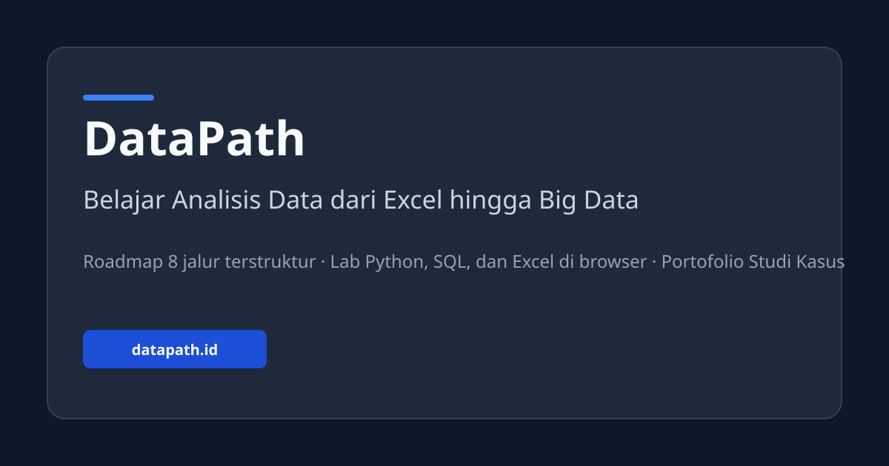

# DataPath

DataPath adalah platform belajar mandiri analisis data berbahasa Indonesia yang memandu pembelajar dari Excel dasar, SQL, Python, statistik, hingga visualisasi data dan big data dalam satu alur terstruktur. Setiap jalur dilengkapi pelajaran interaktif berbasis MDX, kuis evaluasi, latihan sandbox langsung di browser (Excel Grid, SQLite via `sql.js`, dan Python via Pyodide), dashboard gamifikasi, catatan pribadi Markdown, serta portofolio studi kasus publik yang dapat dibagikan ke rekruter.


> *Placeholder pratinjau aplikasi. Ganti gambar di atas dengan tangkapan layar produksi setelah deployment di Vercel.*

---

## Tech Stack


- **Frontend & Routing**: React 19, TypeScript, Vite 6, React Router DOM 7 (`React.lazy` code-splitting per halaman)
- **Desain & Visualisasi**: Tailwind CSS v4, Lucide React, Motion (`motion/react`), Recharts
- **Materi & Dataset**: MDX (`@mdx-js/rollup`, `remark-gfm`) dan dataset sintetis CSV (±500 baris `penjualan-toko.csv` & versi kotor)
- **Latihan In-Browser**: Grid Excel Interaktif, SQLite in-memory (`sql.js` WebAssembly), dan Python + pandas (`Pyodide` Web Worker)
- **Backend & Penyimpanan**: Supabase (Auth, PostgreSQL, Row Level Security) dengan fallback `localStorage` otomatis

---

## Cara Menjalankan di Lokal

1. **Kloning repositori & pasang dependensi**
   ```bash
   git clone <url-repositori-anda> datapath
   cd datapath
   npm install
   ```

2. **Siapkan environment variable**
   Salin file `.env.example` menjadi `.env.local`:
   ```bash
   cp .env.example .env.local
   ```
   Isi nilai proyek Supabase Anda pada `.env.local` (kosongkan jika hanya ingin mencoba mode lokal dengan `localStorage`):
   ```env
   VITE_SUPABASE_URL="https://contoh-proyek-anda.supabase.co"
   VITE_SUPABASE_ANON_KEY="contoh-anon-public-key-anda"
   ```

3. **Jalankan server pengembangan**
   ```bash
   npm run dev
   ```
   Buka `http://localhost:3000` di browser Anda.

4. **Jalankan test, type-check, dan build produksi**
   ```bash
   npm test
   npm run lint
   npm run build
   ```

---

## Setup Database Supabase (`supabase/schema.sql`)

1. Buat proyek baru di [Supabase Dashboard](https://supabase.com/dashboard).
2. Buka menu **SQL Editor** di proyek Supabase Anda, lalu salin seluruh isi file `supabase/schema.sql` dan jalankan (**Run**).
3. Skema tersebut menyiapkan tabel `profiles`, `lesson_progress`, `quiz_attempts`, `exercise_attempts`, `lesson_notes`, `user_gamification`, dan `projects` beserta kebijakan **Row Level Security (RLS)** serta trigger `handle_new_user()`.
4. Buka **Authentication → URL Configuration**:
   - Atur **Site URL** ke domain Vercel Anda (misalnya `https://datapath.vercel.app`) atau `http://localhost:3000` saat pengembangan.
   - Tambahkan Redirect URLs yang diizinkan (`https://datapath.vercel.app/**`).
5. Salin **Project URL** dan **anon public key** dari **Project Settings → API** untuk dimasukkan ke `.env.local` dan Environment Variables Vercel.

---

## Panduan Deployment ke Vercel

1. **Unggah kode ke GitHub/GitLab/Bitbucket**.
2. Buka [vercel.com](https://vercel.com) → klik **Add New… → Project** → pilih repositori DataPath Anda.
3. Pada **Framework Preset**, pastikan terpilih **Vite** (`Build Command`: `npm run build`, `Output Directory`: `dist`). File `vercel.json` sudah otomatis mengatur SPA rewrite, security headers, caching aset, serta region `sin1` (Singapura).
4. Buka bagian **Environment Variables** dan tambahkan:
   - `VITE_SUPABASE_URL` = URL proyek Supabase Anda
   - `VITE_SUPABASE_ANON_KEY` = anon public key Supabase Anda
5. Klik **Deploy** dan tunggu proses build selesai. Setelah live, pastikan domain Vercel tersebut didaftarkan di **Supabase → Authentication → URL Configuration → Site URL**.

---

## Struktur Folder

```text
datapath/
├── content/                  # Materi pelajaran interaktif berbasis MDX
│   └── excel/                # 5 pelajaran Track 1 (Excel untuk Analisis Data)
├── public/                   # Aset statis yang langsung dilayani di root URL
│   ├── datasets/             # Dataset CSV sintetis (bersih & kotor)
│   ├── og-default.svg        # Gambar Open Graph fallback
│   ├── robots.txt            # Aturan crawler mesin pencari
│   ├── sitemap.xml           # Peta situs statis halaman utama
│   └── sql-wasm.wasm         # Binary WebAssembly SQLite untuk sql.js
├── src/                      # Kode sumber aplikasi React + TypeScript
│   ├── components/           # Komponen UI, landing, layout, latihan, portofolio
│   ├── context/              # AuthContext & ThemeContext
│   ├── data/                 # Kurikulum 8 track & contoh studi kasus
│   ├── hooks/                # Custom hooks (useProgress, dll.)
│   ├── lib/                  # Utilitas murni, SEO helper, evaluator & unit test
│   ├── pages/                # Halaman rute dengan React.lazy code-splitting
│   ├── services/             # Service layer Supabase + fallback localStorage
│   └── workers/              # Web Worker Pyodide untuk Python di browser
├── supabase/                 # Skema SQL PostgreSQL & kebijakan RLS
│   └── schema.sql
├── .env.example              # Template environment variable tanpa kredensial asli
├── LICENSE                   # Lisensi MIT
├── vercel.json               # Konfigurasi rewrite SPA, headers & region sin1
└── vite.config.ts            # Konfigurasi Vite, MDX, manualChunks & analyzer
```

---

## Lisensi

Proyek ini dirilis di bawah lisensi [MIT](./LICENSE).
